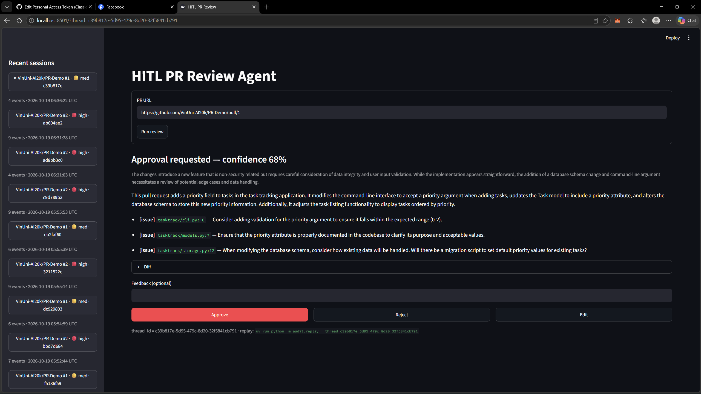
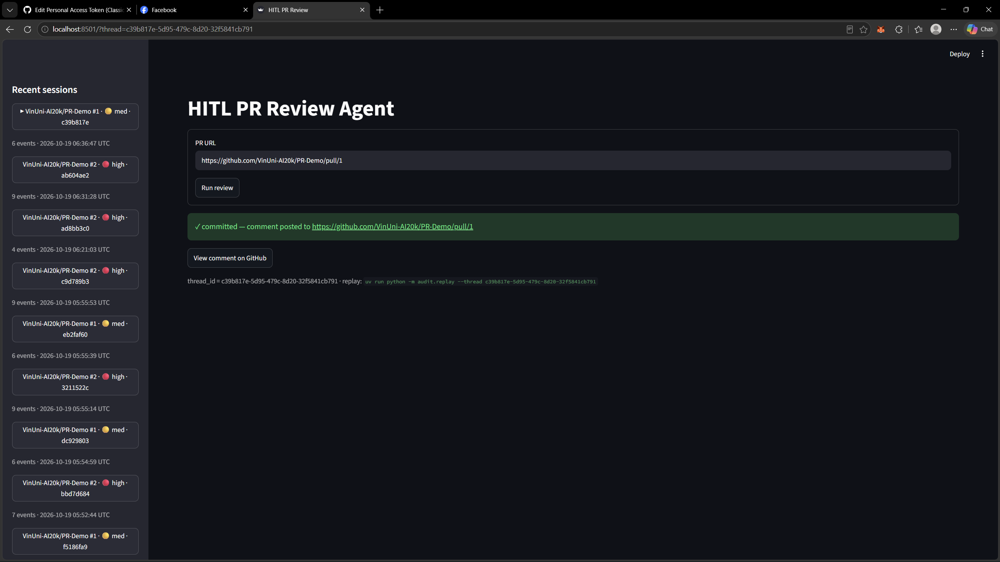
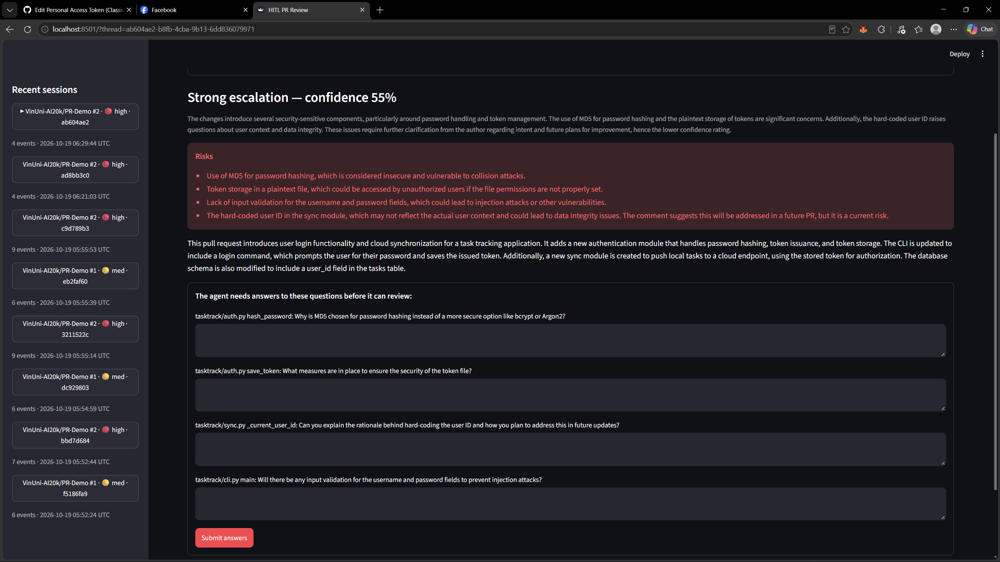
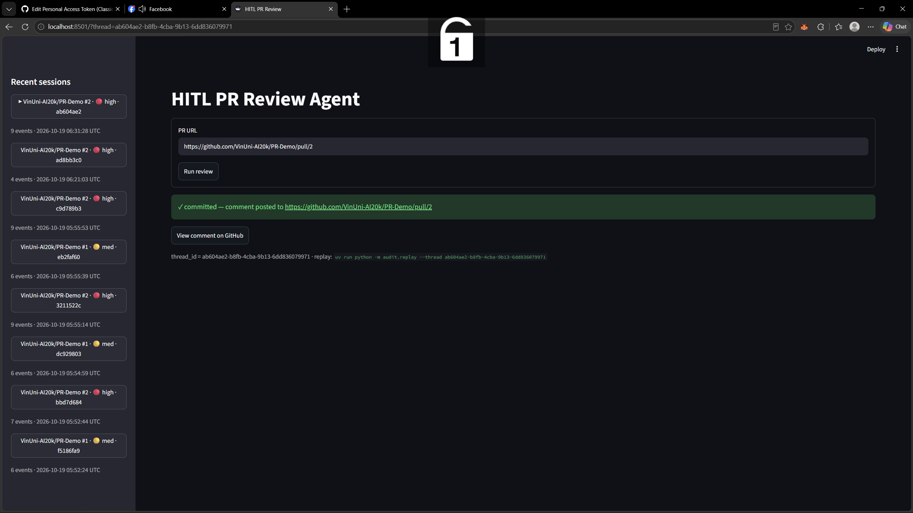
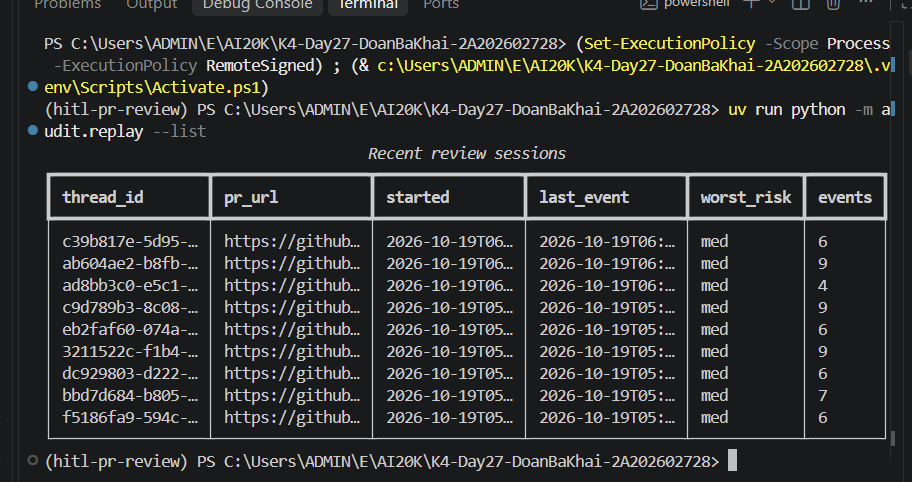
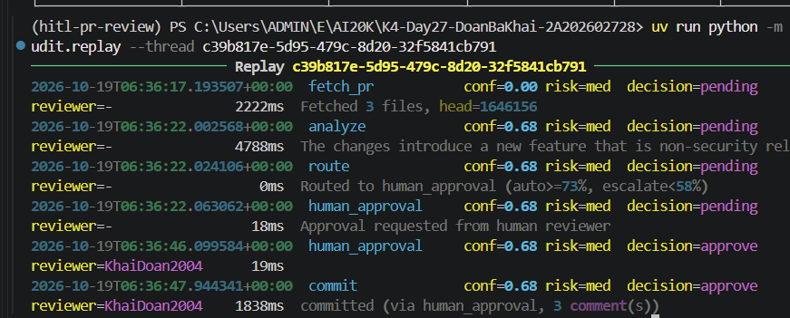

# Bài nộp — Day27 Track 3: HITL PR Review Agent

**Sinh viên:** Doan Ba Khai — 2A202602728 · GitHub: `KhaiDoan2004`

Agent review PR bằng LangGraph, có human-in-the-loop: định tuyến theo confidence, dừng bằng `interrupt()` để người review duyệt hoặc trả lời câu hỏi, ghi audit trail vào SQLite, và giao diện duyệt bằng Streamlit.

## Kết quả theo yêu cầu đề bài

| Yêu cầu | Trạng thái | Bằng chứng |
|---|---|---|
| HITL agent (LangGraph `interrupt()`) | ✅ | [exercise_2_hitl.py](exercises/exercise_2_hitl.py), [exercise_3_escalation.py](exercises/exercise_3_escalation.py) |
| Confidence-based routing (≥73% / 58–72% / <58%) | ✅ | [exercise_1_confidence.py](exercises/exercise_1_confidence.py) — PR #1 → `human_approval`, PR #2 → `escalate` (ổn định qua 3 lần chạy) |
| Audit trail + replay | ✅ (SQLite, theo hướng dẫn lab) | [exercise_4_audit.py](exercises/exercise_4_audit.py), ảnh 5–6 |
| Approval UI (Streamlit) | ✅ | [app.py](app.py), ảnh 1–4 |
| Agent đăng review lên PR thật | ✅ | [Comment PR #1](https://github.com/VinUni-AI20k/PR-Demo/pull/1#issuecomment-6261257225) · [Comment PR #2](https://github.com/VinUni-AI20k/PR-Demo/pull/2#issuecomment-6261177660) |

## Demo hai nhánh có người duyệt

### PR #1 — `human_approval` (confidence 68%)
LLM phát hiện thiếu migration cho database cũ → hỏi duyệt → reviewer bấm **Approve** → agent đăng comment.

| Thẻ duyệt | Sau khi Approve |
|---|---|
|  |  |

### PR #2 — `escalate` (confidence 55% → 75%)
LLM thấy rủi ro bảo mật (MD5, token lưu plaintext, user_id hard-code, thiếu validate input) → hỏi reviewer 4 câu cụ thể có nêu file/hàm → tổng hợp lại review với câu trả lời (confidence lên 75%) → reviewer xác nhận → agent đăng comment.

| Form câu hỏi escalate | Sau khi đăng review đã chỉnh |
|---|---|
|  |  |

### Audit trail
Mỗi node ghi một dòng `AuditEntry`. Node có `interrupt()` ghi hai dòng: `pending` trước khi dừng và quyết định thật sau khi resume.

| `audit.replay --list` | `audit.replay --thread` (PR #1) |
|---|---|
|  |  |

Replay phiên PR #2 (`ab604ae2-…`):
```
fetch_pr         conf=0.00 risk=med  decision=pending   reviewer=-
analyze          conf=0.55 risk=high decision=pending   reviewer=-
route            conf=0.55 risk=high decision=escalate  reviewer=-
escalate         conf=0.55 risk=high decision=pending   reviewer=-
escalate         conf=0.55 risk=high decision=escalate  reviewer=KhaiDoan2004
synthesize       conf=0.75 risk=low  decision=pending   reviewer=-
confirm_refined  conf=0.75 risk=low  decision=pending   reviewer=-
confirm_refined  conf=0.75 risk=low  decision=approve   reviewer=KhaiDoan2004
commit           conf=0.75 risk=low  decision=approve   reviewer=KhaiDoan2004   committed (via escalate)
```

## Những điểm làm thêm / quyết định thiết kế

- **Prompt có thang điểm confidence.** Với prompt gốc ("Senior reviewer. Structured output."), PR #1 có lúc bị chấm 55% và escalate nhầm. Thang điểm mới tách lỗi chức năng (58–72%, cần duyệt) khỏi lỗi bảo mật (<58%, cần hỏi), dùng chung cho cả 4 bài.
- **Không ghi audit trùng khi resume.** Node có `interrupt()` chạy lại từ đầu khi resume, nên dòng `pending` sẽ bị ghi hai lần. `already_audited()` kiểm tra trước khi ghi.
- **Bước xác nhận sau escalation** (`confirm_refined`, trong `app.py`). Đúng theo yêu cầu bài 5: review đã chỉnh được hiện ra để reviewer xác nhận trước khi đăng; nếu bấm Discard thì không đăng.
- **Giữ phiên khi tải lại trang.** `thread_id` lưu trong `st.session_state` và `?thread=` trên URL; khi mở lại, trạng thái được khôi phục từ checkpointer `AsyncSqliteSaver`.
- **Sidebar xếp rủi ro đúng thứ tự.** `audit/replay.py` có sẵn dùng `MAX(risk_level)` so theo chữ cái nên cột `worst_risk` ở ảnh 5 luôn ra `med`. Sidebar Streamlit xếp đúng high > med > low (file có sẵn không bị sửa).
- **LLM:** dùng OpenAI API trực tiếp (`gpt-4o-mini`, `LLM_BASE_URL=https://api.openai.com/v1`), không sửa `common/llm.py`.

## Giới hạn

- Nhánh `auto_approve` (≥73%) đã có code, nhưng chưa demo vì không có PR demo nào đủ đơn giản để đạt ngưỡng.
- Dùng SQLite thay PostgreSQL theo hướng dẫn của lab.

## Chạy lại

```bash
uv sync
cp .env.example .env    # điền OPENROUTER_API_KEY (hoặc key OpenAI + LLM_BASE_URL), GITHUB_TOKEN (scope public_repo), GITHUB_USER
uv run python exercises/exercise_1_confidence.py --pr https://github.com/VinUni-AI20k/PR-Demo/pull/1
uv run streamlit run app.py
uv run python -m audit.replay --list
```
